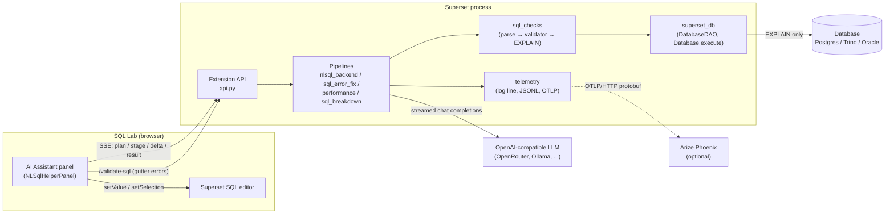
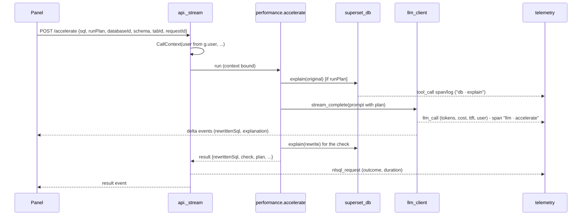

# Architecture

The extension is a Superset extension (`.supx`) with two halves:

- a **frontend** panel registered at SQL Lab's `sqllab.rightSidebar` view location, sitting beside
  Superset's own SQL editor (it never replaces it), and
- a **backend** REST API (`/extensions/waxwing/nltosqlandback/...`) loaded into Superset's own
  Flask process at startup.

The browser never talks to an LLM directly: every model call is made by the backend, so the API key
stays server-side, every call can be logged against the Superset user who caused it, and a local
Ollama needs no CORS setup.

## The one rule about databases

The extension has no database connections of its own and **never runs a user's SQL for data**. The
only things it ever asks a database are to *plan* a query (`EXPLAIN`, never `EXPLAIN ANALYZE`) and
to describe its own structure (Interrogate DB, below), and only through Superset:

- `superset_db.resolve_database` looks the tab's database up with `superset_core`'s `DatabaseDAO`,
  whose base filter is Superset's "databases this user can access", plus
  `security_manager.can_access_database`.
- `superset_db.explain` refuses anything that isn't exactly one read-only query
  (`query_plan.check_plannable`: no DML/DDL anywhere, including data-modifying CTEs), then runs the
  engine's `EXPLAIN` through `Database.execute` - Superset's own execution path, with its
  disallowed-function/table checks, DML permission check, RLS and Query audit record. (So the plans
  show up in Superset's query history for the user, like any SQL Lab query.)

| Engine | Statement | Read back as |
|---|---|---|
| PostgreSQL | `EXPLAIN (FORMAT JSON) …` | node tree → outline, total cost, warnings |
| Trino / Presto | `EXPLAIN (FORMAT JSON) …` (distributed) | fragments → outline (NaN estimates dropped) |
| Oracle | `EXPLAIN PLAN SET STATEMENT_ID … FOR …` then `DBMS_XPLAN.DISPLAY` | its own text; cost from the Id 0 row |
| SQLite | `EXPLAIN QUERY PLAN …` | rows → outline; full scans flagged |
| MySQL | `EXPLAIN FORMAT=JSON …` | JSON text; query cost |

Postgres 17, Trino and Oracle Free 23 were exercised for real through a Superset 6.1 instance's
`Database.execute` while building this; the SQLite and MySQL readers are written from their
documented output shapes and are untested against a live database. Superset's `utils.timeout` is SIGALRM-based and silently
does nothing off the main thread, so there is no hard timeout on a plan - acceptable for `EXPLAIN`,
and another reason `ANALYZE` is never used.

## Request flow

Every LLM-backed endpoint is a server-sent event stream. `api._stream`:

1. builds a `CallContext` (`request_context.py`): the endpoint, **the Superset user from `g.user`**
   (never from the request body), the request id, and the tab's `databaseId`/`catalog`/`tabId`
   from the body - never its schema: queries here qualify every table with its schema, so nothing
   (prompts, plans, interrogation, validation) depends on which one SQL Lab has selected;
2. binds it in a context variable *inside* the response generator (a streamed body runs after the
   view returns), so everything below - every LLM call, every plan - can read it;
3. forwards the pipeline's `plan`/`stage`/`reset`/`delta` events, then a `result`;
4. records the request as a whole once it ends, however it ends (`telemetry.record_request`).

## Endpoints

| Endpoint | What it does | Pipeline |
|---|---|---|
| `POST /generate-sql` | question → SQL | `nlsql_backend.generate_sql` |
| `POST /update-sql-from-nl` | changed question → edited SQL | `nlsql_backend.update_sql_from_nl` |
| `POST /refine-sql` | instruction → edited SQL | `nlsql_backend.refine_sql` |
| `POST /generate-nl` | SQL → one-paragraph description | `nlsql_backend.generate_nl` |
| `POST /update-nl-from-sql-diff` | SQL edit → edited description | `nlsql_backend.update_nl_from_sql_diff` |
| `POST /describe-breakdown` | SQL → overview + sections with line ranges, each with the tables it reads and hints (sections streamed as they're written) | `sql_breakdown.describe_breakdown` |
| `POST /explain-sql-error` | errors → explanation + corrected SQL | `sql_error_fix.explain_and_fix` |
| `POST /accelerate` | SQL (+ plan) → checked faster rewrite | `performance.accelerate` |
| `POST /explain-plan` | SQL → plan → plain-English explanation | `performance.explain_plan` |
| `POST /query-plan` | SQL → plan (JSON, no model; `includeTree` adds the node tree for the Query Estimator) | `superset_db.explain` |
| `POST /format-sql` | SQL → laid out one clause per line (JSON, no model) | `sql_format.format_sql` |
| `POST /validate-sql` | SQL → Superset's own SQL validator's findings, or where the engine has none (Oracle, Trino…) a sqlglot parse in its dialect - syntax only, `checkedBy: "parser"` (JSON, no model, the database isn't contacted; 422 only when the dialect is unknown) - what the editor's gutter errors come from, asked here so it's traced | `superset_db.validate` |
| `POST /interrogate-db` | every schema of the tab's database → kept structure | `db_interrogation.interrogate` |
| `GET /db-knowledge` | whether/when the tab's database was interrogated (`full=true`: the tables) | `schema_knowledge` |
| `POST /db-knowledge/forget` | throw that away | `schema_knowledge` |
| `POST /cancel` | cancel a call by request id (JSON) | `cancellation` |
| `POST /feedback` | a thumbs up/down (and why) on a result, filed under that result's trace (JSON, no model) | `telemetry.record_feedback` |

## Checking generated SQL (`sql_checks.py`)

Any SQL a model writes - a generation, a refinement, a fix - must pass, in order:

1. **sqlglot parse in the database's dialect** (`superset_core.queries.query.get_sqlglot_dialect`,
   i.e. Superset's own mapping), not sqlglot's generic dialect;
2. **Superset's SQL validator** for the engine, when `SQL_VALIDATORS_BY_ENGINE` configures one;
3. **the database plans it** (`EXPLAIN`), which catches unknown tables/columns and type errors that
   no parser can (`NLSQL_VALIDATE_WITH_EXPLAIN`, default on whenever the tab has a database).

A failure at any step triggers the one retry, with the reason in the prompt ("Problem: relation
"nope" does not exist"). A check that *couldn't be made* - no database, no access, a privilege error,
an engine planning doesn't support - is skipped and said so in the step detail, not counted against
the SQL.

## Accelerate (`performance.py`, `sql_rewrite_check.py`)

After waxwing-sql's `PlanAdvisor` and `RewriteChecker` (its decisions B74, B102, B119):

- **Run query plan first** (`runPlan`, default on): the original is planned and the model gets the
  plan outline and the warnings derived from it (large sequential scans, nested loops over a seq
  scan, big sorts, possible cross joins). Off: the model works from the SQL alone. A planning failure
  doesn't stop the call; the result says why there was no plan.
- The rewrite is **checked before anyone sees it**: unchanged (token-equal) → `Unchanged`; the
  database rejects it when it accepted the original → `Invalid` (retried once with the reason);
  otherwise its output columns/DISTINCT/ORDER BY/LIMIT are compared with the original's, replaced
  `NOT IN`s are flagged for NULL semantics, a select-list subquery turned into an inner join is
  flagged for dropping unmatched rows, an `IN (subquery)` turned into a join is flagged for repeating
  rows, and the two plans' costs and warnings are compared. Any result-changing finding →
  `MayDiffer`; none → `Unverified` (never "equivalent": nothing here proves that).
- Nothing changes in the editor until the user applies it (an undo step of its own), or opens it in
  a new SQL Lab tab, leaving the original alone - waxwing-sql's behaviour.
- **Each change is tied to the SQL by quotes, never positions** (`change_anchors.py`). This holds
  for every call that rewrites SQL already in the editor: Accelerate, Refine, Ask's update and Fix
  (`changes_instructions` gives their prompts the same wording). A fresh Generate SQL has no changes,
  and any changes the model volunteers are dropped. The model returns
  `changes: [{summary, why, before, after}]`, where `before` and `after` are copied out of
  the original and the rewrite. Models copy text reliably but count characters badly. A position
  would also go wrong as soon as the SQL is reformatted, edited by hand, or compared with a version
  two steps back.

  The backend finds each quote as tokens (spacing, line breaks, comments and keyword/name case don't
  matter; strings and quoted names must match) and replaces it with the exact text it matched. A
  quote that isn't found is dropped, so the change keeps its reason but isn't pinned anywhere. The
  request's log line counts both (`changes`, `changesAnchored`). Generated SQL is checked against
  the formatted text that goes into the editor. Formatting can change tokens as well as spacing
  (`!=` becomes `<>`, `a::int` becomes `CAST(a AS INT)`), so a quote containing those isn't found
  and its change isn't placed.

  The applied version stores its changes in `ancestry`. When the Compare pane draws two versions,
  `changeNotes.ts` finds the quotes again in that pair, tokenizing the same way (keep the two in
  step), and only then works out character ranges and lines.

## Semantic schema

Prompts for generating SQL from a question get a schema section from the bundled semantic schema via
an embedding search (`schema_filter.py`), **only when `NLSQL_SEMANTIC_SCHEMA_ENABLED = True`**. It's
off by default: the first deployments have no semantic description of their databases, so the
pipelines use what Interrogate DB found in the tab's database if it has been run (see below), and otherwise work from the SQL itself (and, for performance work, its plan) - in which case
the "Finding the right tables" step is left out of the progress display. The loader accepts both the original single-schema
JSON and sql-helper's multi-schema `DatabaseDescription` shape.

## Interrogate DB (`db_interrogation.py`, `schema_knowledge.py`)

Most databases a Superset points at have no semantic description, so a model asked for SQL from a
question has to guess the tables. But a database can describe its own *structure* without anyone
reading its data, and that's what Interrogate DB asks for - for every schema of the tab's database:

1. **List the schemas** (`superset_db.list_schemas`): `Database.get_all_schema_names` (Superset's
   cache skipped), less the database's own (`information_schema`, `pg_catalog`, Oracle's `SYS`,
   `SYSTEM` and the rest - `NLSQL_INTERROGATE_EXCLUDE_SCHEMAS`), narrowed to those this user has
   any access to (`security_manager.get_schemas_accessible_by_user`); `NLSQL_INTERROGATE_SCHEMAS`
   limits it further.
2. **Read** each schema (`superset_db.list_tables`, `schema_reader`): table and view names, then
   each one's columns, types, column comments, primary and foreign keys, indexes and enum values.
   One Superset inspector (`Database.get_inspector`) per schema, through the engine spec's own
   `get_columns`/`get_indexes` - the model's per-table methods open a new engine per call, which over
   hundreds of tables is most of the time. Only the tables this user may see
   (`security_manager.get_datasources_accessible_by_user`); an index naming columns the table
   doesn't have (Trino reports an unpartitioned Iceberg table's `$partitions` summary as one) is
   dropped. Capped at `NLSQL_INTERROGATE_MAX_TABLES` (3000) in all.
3. **Size** (`superset_db.estimate_rows_progressively`, `NLSQL_INTERROGATE_ROW_ESTIMATES`): one
   `EXPLAIN` of `SELECT 1 FROM s.a UNION ALL SELECT 1 FROM t.b …` per 60 tables, across schemas -
   planned, not run - and each table's estimated rows read back: by the name of the step scanning it
   (Postgres' `schema.table alias`, Trino's `catalog:schema.table$data@snapshot`, Oracle's upper
   case), or else by its place among the union's branches (Oracle may answer `SELECT 1 FROM t` from
   t's primary-key index, and name only the index). No two tables in a batch share a name. A batch
   the database won't plan is split in two and retried, down to the single tables it refuses -
   recorded as problems, and as a note on the table the prompt shows (usually a missing grant, which
   a query on it would hit too).
4. **Describe** - only with `NLSQL_INTERROGATE_DESCRIPTIONS` (off by default; table comments are
   only read then too): each schema's structure goes to the model in batches (~9k characters / 25
   tables a call), which writes one sentence per table, up to three synonyms, a few words for each
   column whose meaning isn't obvious from its name, and joins it can see that no foreign key
   declares (kept only if both columns exist). Off by default because over many schemas that's a lot
   of model calls, and a much bigger prompt; the code stays for an option to turn it on per run.
5. **Keep** it as a `DatabaseDescription` (sql-helper's multi-schema shape, which `semantic_schema`
   reads) in Superset's key-value store, keyed by database/catalog - shared by every user and
   worker, surviving restarts - with a 60-second per-process copy in front. (Format version 2; a
   per-schema record from the first version isn't read.)

From then on `nlsql_backend.schema_preamble` gives every prompt about that database the whole of it -
**no embedding search** (a later version may bring back semantic descriptions with a similarity
search to pick tables). Without descriptions a table is a line or three:

    movie_data.ratings ≈100.8k rows
      user_id INTEGER PK, movie_id INTEGER PK ->movie_data.movies.movie_id, rating REAL, rated_at TIMESTAMP
      idx: (movie_id)

under a header that says every table is schema-qualified and must be written that way, what PK,
`->`, `idx` and `≈` mean, and - when there are any - that `[LOB]` columns can't be grouped, sorted
or compared (the commonest way a model's Oracle SQL fails). Past `NLSQL_SCHEMA_MAX_CHARS` (120k) the
types and indexes go; past that the tables sharing the fewest words with the request are left out
(the prompt says how many). A user sees only the tables they have access to, in the panel and in
their prompts. `NLSQL_SEMANTIC_SCHEMA_ENABLED` still wins when it's set.

## Generated SQL is formatted (`sql_format.py`)

SQL the model writes (Ask, Refine, clarification retries) is laid out before it reaches the editor
(`nlsql_backend.formatted`, `NLSQL_FORMAT_GENERATED_SQL`), after it has passed the checks. The
layout is Superset's own - `superset.sql.parse.SQLScript(sql, engine).format()`, what SQL Lab's
Format SQL button does, i.e. sqlglot in the database's dialect, pretty-printed with comments kept -
so it's deterministic and costs no model call. sqlglot formats by parsing and regenerating, so it
can respell things (`!=` → `<>`, `x::int` → `CAST(x AS INT)`, keywords and functions upper-cased).
Two guards keep it from ever changing what a query means: SQL it can't parse (or keeps only as an
opaque command) is left as written, and the formatted text must parse back to the same syntax tree as
the original, or the original is kept (Oracle `LIMIT` → `FETCH FIRST` is one such case). The
Accelerate and Fix rewrites aren't formatted, so their diffs against the editor's SQL stay readable.

## How the model writes its prose (`prose.py`)

Every streaming call carries the panel's `verbosity` ("brief" or "full", the **Brief** checkbox);
`api` puts it on the `CallContext`, and each prompt appends `prose.instructions(...)` naming its
prose fields. Brief is asked for, not cut down to afterwards: output length is most of a call's
time, so having the model write both forms would slow every call, brief ones included. The same
instructions have the model mark a few hard terms inline as `[[term|meaning]]`, which the panel's
`Prose` component draws with a tooltip; `prose.strip_terms` (and the frontend's `plainText`)
remove the markup from anything that comes back as input.

## The panel and its layouts (`panelModel.tsx`, `layouts/`)

The side panel is in two halves. `usePanelModel` holds everything the panel does: the calls, the
undo timeline, and each SQL Lab tab's own state. It hands back a `PanelModel`, which is each of the
four workflows already drawn, with whether it is available, running, unread or wants attention,
plus the error, the schema bar and the footer. The chosen layout arranges that and nothing more.
`NLSqlHelperPanel` draws the header and the database bar, then the layout.

Layouts are registered in `layouts/index.ts`, each one a `defineLayout({ id, name, description,
Component })` in its own folder. The id is what `panelLayout.ts` stores in the browser and what
feedback carries as its `variant.layout`, so layouts can be compared in the telemetry. An id that is
stored but no longer registered falls back to the first layout. A layout can't change what a
workflow does. Doing that means changing the workflow itself, in `panelModel.tsx` or its
component.

## Under the editor: Break it down and Query Estimator

Both are `sqllab.panels` views (`index.tsx`). Superset renders every such tab all the time, hidden
or not, so each waits until it's on screen (an `IntersectionObserver`) before doing anything costly,
and measures the pane to fill its height (the host gives extension tabs no height of their own).

- **Break it down** (`BreakdownPane`) shares the per-tab breakdown with the side panel's Describe
  tab (`breakdownAction.runBreakdown`, one call slot). With "Lay the SQL out first" the backend
  formats the query (`sql_format`: sqlglot in the database's dialect, comments kept; anything that
  doesn't parse is left alone) and the sections' line numbers refer to that layout, which the result
  carries ("Use this layout" puts it in the editor, as an undoable step, after which the sections
  can be selected there). A layout identical to the editor's SQL counts as the editor's own.
  Syntax colouring is a small tokenizer (`sqlHighlight.ts`), no dependency.

  The call streams more than text: a `partial` event with the SQL the sections will refer to, then
  one with the sections so far each time the model finishes another (`streaming_json.complete_array_items`
  reads finished items out of the half-written JSON), so cards appear one by one. Its prompt holds
  only the tables the query reads (`query_tables.tables_used` → `nlsql_backend.query_schema_preamble`;
  Describe uses the same), and each section comes back with those tables' kind and planner row
  estimate plus **hints**: a join or filter, in that section, on a table of at least
  `NLSQL_BREAKDOWN_LARGE_TABLE_ROWS` rows (1M) on a column no index or primary key starts with - only
  for databases whose tables have indexes at all, so Trino/Iceberg gets none. All of it comes from
  sqlglot's token positions and the interrogated structure; no model, no database call.

  Each tab remembers its last 12 breakdowns by the SQL they were made from (`tabState.breakdownFor`),
  so undoing back to SQL broken down before shows its breakdown again without a call.
- **Query Estimator** (`EstimatorPane`, `estimate.ts`) calls `/query-plan` with `includeTree` when
  it comes into view with SQL it hasn't estimated, and on Re-estimate - not on every keystroke,
  since each is a planner call and a query-history entry. Impact is banded on the planner's total
  cost (< 10k Low, < 1M Moderate, < 100M High, else Critical; at least High for a cartesian product)
  or, for an engine without costs, on the warnings. Oracle's `DBMS_XPLAN` table is read into a tree
  as well (nesting from the Operation column's indent, predicates as details, its Time estimate as
  the Time metric).

## Telemetry (`telemetry.py`, `otlp.py`)

Every LLM and embedding call becomes an `LlmCallRecord`: endpoint, purpose and attempt, the user's id
and username, request id, database/catalog/schema/dialect, trace id, requested and served model,
provider, response id, finish reason, **input/output/total/reasoning/cached tokens and cost** (from
the provider's `usage`, requested with `stream_options.include_usage`), time to first token,
duration, character counts, outcome and error - and optionally the prompt and response text.

It is written as one `llm_call {json}` line on the `waxwing.nltosqlandback.llm_calls` logger, to
`NLSQL_LLM_LOG_FILE` as JSONL if set, and - when `NLSQL_PHOENIX_ENDPOINT` is set - as an OpenInference
`LLM` span to Arize Phoenix (or any OTLP/HTTP collector). Each API request is one trace: a `CHAIN`
span named after the endpoint (`describe_breakdown`) - its input the request's SQL or question, its
output the final JSON - with the model calls beneath it as `LLM` spans named `llm · <endpoint>`
(carrying the full prompt and response), `EMBEDDING` spans, and `TOOL` spans for what the database
was asked: `db · explain` (a plan) and `db · validate` (Superset's SQL validator). `user.id` is on
every span and the SQL Lab tab is the `session.id`, so Phoenix's sessions view shows a tab's
back-and-forth with the panel.

The LLM and embedding endpoints can be told who a call is for as well. With `NLSQL_LLM_USER_HEADER`
set, every call made for a user carries the Superset username in that header, read from the
request's `CallContext` (`request_context.user_headers`). The username is percent-encoded UTF-8,
with `%` encoded too, so it always decodes. Header values are Latin-1 only, and `http.client` would
fail the call on anything else. A name HTTP doesn't allow, or one the calls set themselves
(`Authorization`, say), is logged once and not sent. The header is only Superset's word for who is
asking: a gateway can trust it only if it accepts traffic from Superset alone.

**Feedback** on a result goes into the same trace. Every streamed `result` event carries the
request's `traceId` and `spanId`; the panel keeps them with the result, and a thumbs up or down on it
(see [ui.md](ui.md)) is POSTed to `/feedback` with them. That is logged as a `feedback {json}` line
at its own `FEEDBACK` level (25 - between INFO and WARNING, so it's kept wherever INFO is) and sent
as a `feedback · down · Too vague` span that is a child of the rated request's span - so opening the
feedback in the collector or Phoenix shows the prompt, the model's reply and the database calls it
is about. A person changing their mind sends again under the same `feedbackId`; the latest counts.
Each record carries the panel's variant (layout, verbosity), for comparing A/B options.

**Every call is made by the backend.** The browser never talks to a model; its only calls outside the
extension's own API are SQL Lab's (and Superset's database API, once per database, for the engine
name). Even the editor's validation goes through `/validate-sql`, so with a validator configured
(Postgres and Presto in the docker setup) every pause in typing is a small `validate_sql` trace.

Phoenix only accepts OTLP's protobuf encoding and Superset's image has no OpenTelemetry SDK (an
extension can't add Python dependencies to the host), so `otlp.py` writes the protobuf wire format
for the handful of OTLP messages needed by hand. It was checked byte-for-byte against the official
`opentelemetry-proto` decoder. Spans are batched and sent from a daemon thread; a collector that's
down costs at most one warning a minute and never fails a request.

## What came from where

- **superset-llm-integration** (this repo): the four-tab panel, streaming, cancellation, undo/redo,
  the fix workflow - kept as the base, per the brief to keep the UI as close to it as possible.
- **sql-helper**: SQL landing in the right SQL Lab tab when the user switches tabs mid-call
  (`pendingSql`, `hasDrifted`, the render-time editor reset in `useTabEditor`, the `onDidCreateTab`
  payload fix), `SELECT ...` treated as empty, the streamed summary in the progress panel, undo/redo
  that doesn't vanish when stepped back past the first step, the multi-schema semantic schema shape.
  Not ported: the single-column layout (by request) and `NLSQL_DELEGATE_TO_SERVICE` (it forwards
  whole calls to the old sql-helper-service, which would take the LLM calls - and so the logging the
  brief asks for - out of this process; waxwing-sql's server has different routes anyway).
- **waxwing-sql**: Accelerate with "Run query plan first", the plan-to-outline reading, the rewrite
  checker, "Explain the query plan", the telemetry record's field names.
